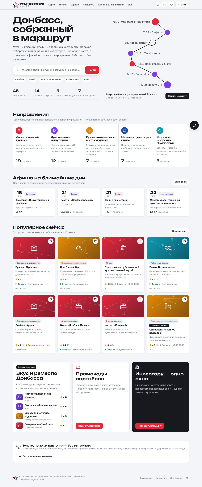

# Код Новороссии — единая цифровая платформа туризма ДНР

Сайт + мобильное приложение + кабинеты бизнеса и инвесторов + панель управления на одном общем API.
Туристу и жителю — куда пойти; предпринимателю — как привлечь посетителей; инвестору — «одно окно».



## Быстрый старт (2 минуты)

Нужен только **Python 3.10+** — сайт уже собран и раздаётся бэкендом.

| ОС | Команда |
|---|---|
| Windows | двойной клик по `run.bat` |
| macOS / Linux | `./run.sh` |
| Docker | `docker compose up --build` |

Откройте **http://localhost:8000** — сайт, **http://localhost:8000/docs** — документация API (OpenAPI).
База SQLite создаётся и наполняется демо-данными при первом запуске (`python -m app.seed` — пересоздать).

### Демо-доступы (пароль у всех `demo123`)

На странице входа есть кнопки быстрого входа — для служебных ролей код 2FA подставляется сам (только в `DEMO_MODE`).

| Роль | E-mail | Что посмотреть |
|---|---|---|
| Администратор (2FA) | admin@kod.ru | Аналитика, вертикали и поля, роли, журнал |
| Модератор (2FA) | moderator@kod.ru | Жалобы (SLA 24 ч), верификация (3 раб. дня), неточности, авторские права |
| Куратор «одного окна» (2FA) | curator@kod.ru | Канбан заявок инвесторов, паспорта и контуры площадок |
| Владелец бизнеса | owner@kod.ru | Кабинет: карточка, ответы на отзывы, экскурсии, промокод, статистика |
| Пользователь | user@kod.ru | Отзывы, избранное, запись, заявка инвестора, паспорт путешественника |
| Эксперт наследия | expert@kod.ru | Закрытое пространство экспертов в «Морском наследии» |

TOTP-секреты для Google Authenticator / Яндекс Ключа: admin `JBSWY3DPEHPK3PXP`, moderator `KRSXG5CTMVRXEZLU`, curator `MFRGGZDFMZTWQ2LK`.

### Мобильное приложение (Kotlin)

Откройте папку `mobile/` в **Android Studio** (Ladybug или новее) → Run. Сервер по умолчанию — `http://10.0.2.2:8000`
(это компьютер из эмулятора). Для реального телефона в той же Wi-Fi: «Ещё → Настройки → Сервер» → `http://IP-компьютера:8000`.
APK собирается и в CI (GitHub Actions, `.github/workflows/ci.yml`) — готовый файл в артефактах сборки.

## Архитектура

```
             ┌──────────────── Общее API (FastAPI, Python) ────────────────┐
 Сайт React ─┤ объекты · вертикали · поиск · отзывы · маршруты · события   ├─ SQLite / PostgreSQL
 PWA, SEO    │ кабинеты · одно окно · модерация · аналитика · чат-бот      │
 Android ────┤ /api/sync/bundle — офлайн-пакет для приложения              ├─ media/ (фото, документы)
 Kotlin      └─────────────────────────────────────────────────────────────┘
```

| Часть | Стек |
|---|---|
| Бэкенд | Python 3.10+, FastAPI, SQLAlchemy 2, JWT, TOTP (pyotp), Snowball-стемминг + RapidFuzz, 13 интеграционных тестов (pytest) |
| Сайт | React 18 + TypeScript + Vite, Leaflet + MarkerCluster, Recharts, PWA (Service Worker), серверная подстановка мета-тегов и JSON-LD |
| Приложение | Kotlin, Jetpack Compose (Material 3), Room, WorkManager, OkHttp + Gson, osmdroid, ZXing; без Google Play Services (подходит для RuStore) |
| Инфраструктура | Docker, docker-compose, GitHub Actions (тесты, сборка веба, сборка APK) |

`DATABASE_URL=postgresql://…` переключает на PostgreSQL без изменений кода. Чат-бот работает без внешних сервисов;
если задать `LLM_API_URL` (любой OpenAI-совместимый, например прокси GigaChat/YandexGPT) — ответы перефразирует LLM на найденных данных.

## Соответствие ТЗ

Полная таблица «пункт ТЗ → где реализовано» — в [docs/TZ-compliance.md](docs/TZ-compliance.md). Кратко:

- **Ядро + вертикали.** 5 вертикалей (туризм, креативные индустрии, промышленный и гастротуризм, инвестиции, морское наследие).
  Администратор создаёт вертикаль, типы объектов и **поля карточки** в панели — сайт подхватывает их без перезагрузки,
  приложение — при синхронизации. Фильтры каталога, слой карты и форма заявки строятся из конфигурации.
- **Карточка объекта:** все поля, статус (открыто / закрыто / временно недоступно), дата проверки, кнопки «Построить маршрут»,
  «В избранное», «Поделиться», «Сообщить о неточности».
- **Карта:** слои по вертикалям, кластеры с числом объектов (клик — приближение, на крупном масштабе — список), моя позиция,
  переключатель «Карта / Список», контуры инвестплощадок.
- **Поиск:** морфология, опечатки, неверная раскладка (`veptq` → «музей»), синонимы («поесть» → кафе); фильтры по вертикали,
  категории, рейтингу, «открыто сейчас», стоимости, формату, меткам и **динамическим полям типа**; сортировка по расстоянию, рейтингу, популярности.
- **Отзывы:** 1–5, текст, фото; редактирование и удаление своих; ответ владельца; владелец не оценивает свой объект; жалоба → модерация с таймером 24 ч.
- **Избранное без интернета**, синхронизация после входа (слияние офлайн-изменений).
- **Маршруты:** готовые тематические (стартовый — «Креативный Донецк»: музей → кофе → библиотека → ДонНТУ → филармония), паузы, время, длительность;
  персональные из избранного с оптимизацией (ближайший сосед + 2-opt); **подбор «маршрут за N часов» по интересам**.
- **Афиша:** календарь, фильтры, запись, экспорт в календарь (.ics).
- **Креативные индустрии:** профили с портфолио и услугами, метки «стажёры / экскурсии / заказы», подтверждение прав на материалы, жалоба на нарушение авторских прав.
- **Промышленный туризм:** расписание экскурсий, размер группы, требования безопасности, статусы допуска, запись, «Сделано в регионе».
- **Инвесторам «одно окно»:** площадки с контурами и паспортом, мастер подбора с объяснением совпадений, единая заявка со статусами, куратором и перепиской, «Новая жизнь площадок» (было/стало).
- **Кадры:** стажировки, курсы, вакансии, наставники; **морское наследие:** истории, аудиогиды (синтез речи на устройстве), материалы жителей с модерацией, закрытое пространство экспертов.
- **Офлайн:** сайт — Service Worker; приложение — Room-кэш всего каталога, офлайн-поиск, офлайн-карта региона, очередь действий.
- **Гео-уведомления:** включаются пользователем, радиус 100–1000 м, ≤ 3 в сутки, «тихие часы», по избранному и интересам.
- **Роли и права:** гость, пользователь (инвестор — профиль), владелец (верификация ЕГРЮЛ/ЕГРИП/ИНН + код по контактам + решение до 3 раб. дней), куратор, модератор, администратор; **обязательная 2FA для служебных ролей**.
- **Интерфейс:** нижняя панель «Карта / Каталог / Избранное / Маршруты / Ещё», туристический режим по умолчанию, профессиональный — отдельно; светлая и тёмная темы; адаптив.
- **Чат-бот «Гид»** и **промокоды партнёров** (скидка 3–5%, QR-код) — из доп. функций презентации.

### Оформление
- 7 цветовых тем (кнопка-кружок в шапке): «Ночной Донбасс», «Донецкая роза», «Азовское море», «Закат над терриконами», «Степь», «Классика», «Классика · синяя» (`web/src/themes/azure.css` — образец для своей темы).
- Три уровня глубины в каждой теме: фон → полосы-секции → карточки; бейджи категорий окрашены цветом направления и читаются в любой теме. Тема перекрашивает интерфейс, рисованные пейзажи и фото-подложки.
- Первый экран — панорама Донецка с «волной», стеклянной каруселью мест и веером фото-карточек; на внутренних страницах — полупрозрачное фото города под заголовком.
- **Свои фото вместо рисунков-заглушек — без кода и пересборки:** положите `photos/places/<имя-места>.jpg` (события — `photos/events/`, карточки направлений — `photos/directions/`, фон главной — `photos/hero.jpg`, разделов — `photos/pages/`). Инструкция — [photos/README.md](photos/README.md), имена файлов для всех мест — `photos/СПИСОК-ИМЁН.md`.

### Киллер-фичи
1. **Подбор маршрута за N часов** — из интересов и времени собирается маршрут с паузой на обед.
2. **Паспорт путешественника** — гео-отметки (до 300 м), штампы, уровни и достижения.
3. **Аудиогиды без записи звука** — синтез речи на устройстве, работает офлайн.
4. **«Ищут, но не находят»** — аналитика запросов без результатов показывает, каких мест не хватает региону.
5. **SEO из коробки** — постоянные адреса, sitemap.xml, мета-теги и Schema.org JSON-LD для каждой карточки.

## Структура

```
backend/   FastAPI: app/{models,routers,search,assistant,routes_engine,seed}.py, tests/
web/       React + TS: src/{pages,admin,ui}, public/sw.js, dist/ (собранный сайт)
mobile/    Android (Kotlin, Compose): app/src/main/java/ru/kodnovorossii/app/{data,ui,geo}
docs/      Соответствие ТЗ, скриншоты
```

Демо-данные: **только реально существующие места** Донецка, Мариуполя и Приазовья (координаты приблизительные).
Телефоны, сайты и графики работы указаны только там, где они известны; если графика нет — интерфейс пишет «График уточняйте».
Демонстрационными остаются отзывы, афиша (кроме хакатона), слоты экскурсий, промокоды, вакансии и инвестплощадки — они показывают механику
и на боевом запуске заполняются владельцами и кураторами. Перед боевым запуском — `DEMO_MODE=false` и свой `SECRET_KEY`.
